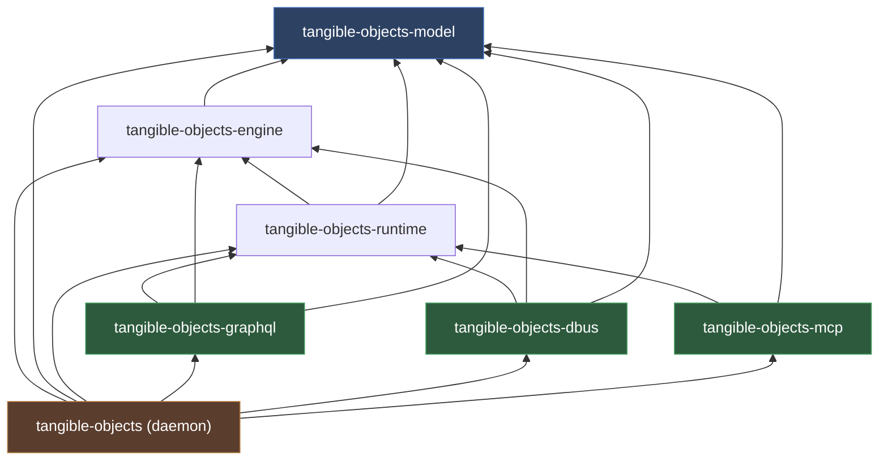

# Architecture

## Crate Dependency Graph

Edges point from a crate to the crate it depends on.

| Crate | Role | Depends on |
| ----- | ---- | ---------- |
| `tangible-objects-model` | Domain types: `TrackedTangible`, `TangiblePattern`, `TangibleSet`, `TouchPoint`, `SetAction` | — |
| `tangible-objects-engine` | Consumes `RawEvent`s, detects tangibles, emits `EngineFrame`/`EngineEvent` | `model` |
| `tangible-objects-runtime` | Event hub: `broadcast<DomainEvent>`, `watch<EngineSnapshot>`, `mpsc<ControlCommand>`; publishes `EngineHandle` | `engine`, `model` |
| `tangible-objects-graphql` | GraphQL query/mutation/subscription via axum + async-graphql | `runtime`, `engine`, `model` |
| `tangible-objects-dbus` | `org.tangibleobjects.Engine1` on the session bus; methods + signals | `runtime`, `engine`, `model` |
| `tangible-objects-mcp` | MCP tools + `tangible://` resources (stdio, streamable HTTP) | `runtime`, `model` |
| `tangible-objects` (daemon) | Binary; owns the device loop, publishes frames, spawns the interface servers | all |

## Interface Endpoints

The daemon can expose three interfaces in parallel, each enabled by a CLI flag:

- **GraphQL** (`--graphql-listen <addr>`): axum server on its own thread and
  tokio runtime. Routes: `GET /` (GraphiQL IDE), `POST /graphql` (queries and
  mutations), `GET /graphql` (WebSocket subscriptions).
- **D-Bus** (`--dbus`): service `org.tangibleobjects.Engine1` on the session bus.
  No TCP port.
- **MCP** (`--mcp-listen <addr>`): axum server on its own thread and tokio
  runtime. Route: `/mcp` (streamable HTTP transport).

GraphQL and MCP are two fully independent HTTP servers: each binds its own
`TcpListener` on its own address and port. Enabling both with the same address
fails with *address already in use*.
