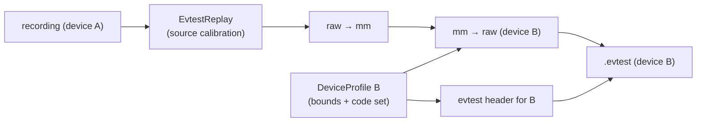
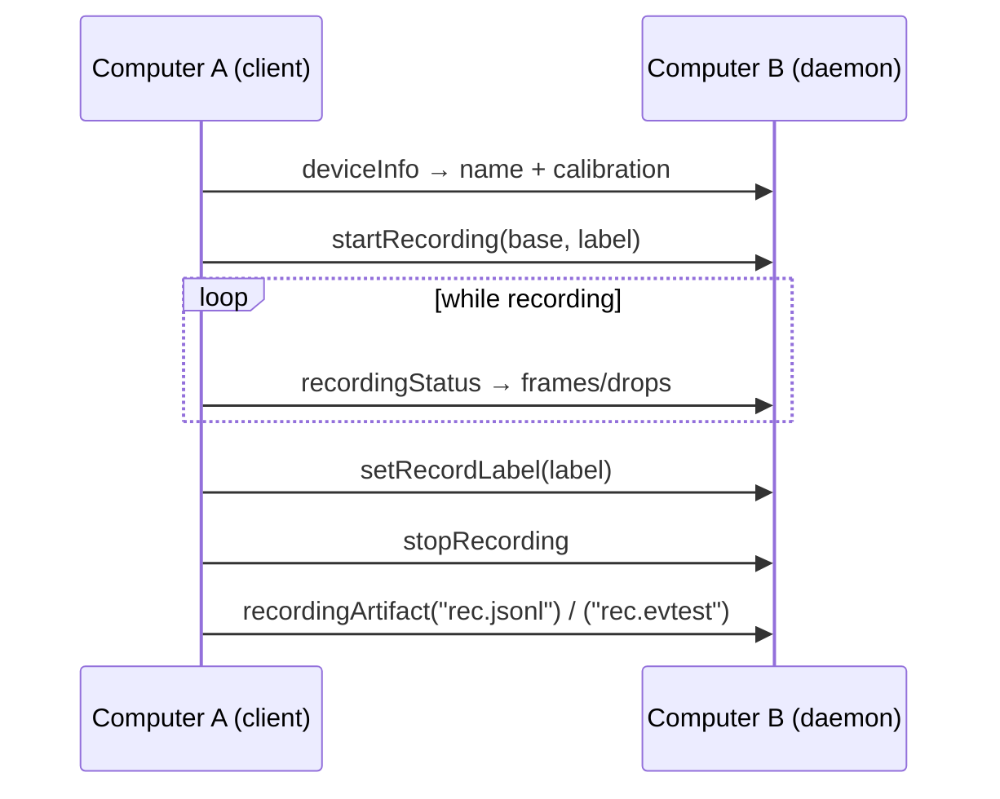

# Cross-Device Conversion

Re-emitting a `.evtest` recording of one touchscreen as the raw event
stream another device would produce — plus the remote endpoints that make
multi-machine recording workflows possible. Data shapes:
[`DATA_MODEL.md`](DATA_MODEL.md).

## Pipeline



`DeviceConverter::convert(input, output)` per event:

- **Position codes** (`ABS_MT_POSITION_X/Y`, legacy `ABS_X/Y`) map
  `raw → mm → raw` through source and target calibrations; out-of-bounds
  values clamp to the target axis range (`ConvertStats::clamped`).
- **Other codes** pass through only when `target.supports(type, code)` —
  unlisted codes drop (`ConvertStats::dropped`).
- **`SYN_REPORT` delimiters and timestamps** pass unchanged — the target's
  `report_rate_hz` is not synthesized.

CLI:

```bash
tangible-objects --convert-device rec-a.evtest --to "Panel B 8k" \
    [--device-profiles devices-extra]
# → rec-a.to-panel-b-8k.evtest
#   Konvertiert: … (6355 Events: 5069 übernommen, 1286 gedroppt, 416 geclampt)
```

The target resolves by registry name (builtins + `--device-profiles`) or a
TOML file path.

### What conversion does not transfer

Source noise/quantization character and update cadence survive as-is —
the target's real jitter is not fabricated. Converted artifacts test
*geometry and pipeline behavior* on a foreign device; they do not replace
a real recording for tolerance tuning.

## Remote access

Interfaces bind `SocketAddr`s — `--graphql-listen 0.0.0.0:8000` /
`--mcp-listen 0.0.0.0:9000` expose the daemon on the LAN. `EngineSnapshot`
carries `device: Option<DeviceInfo>` and
`recording: Option<RecordingStatus>`; interfaces read them instead of
querying the device loop (no reply channel needed).

| Interface | Queries / tools / methods |
|-----------|---------------------------|
| GraphQL   | `deviceInfo`, `recordingStatus`, `recordingArtifact(path)` |
| MCP       | `device_info`, `recording_status`, `recording_artifact(path)` |
| D-Bus     | `DeviceInfo`, `RecordingStatus` (key-value lists) |

### Remote recording workflow (computer A drives B)



`recording_artifact` is restricted to `*.jsonl` / `*.evtest` /
`*.dataset.jsonl` paths without `..` components — a LAN/debug convenience
for pulling artifacts, not a file server. Authentication: none — LAN
bindings only.
