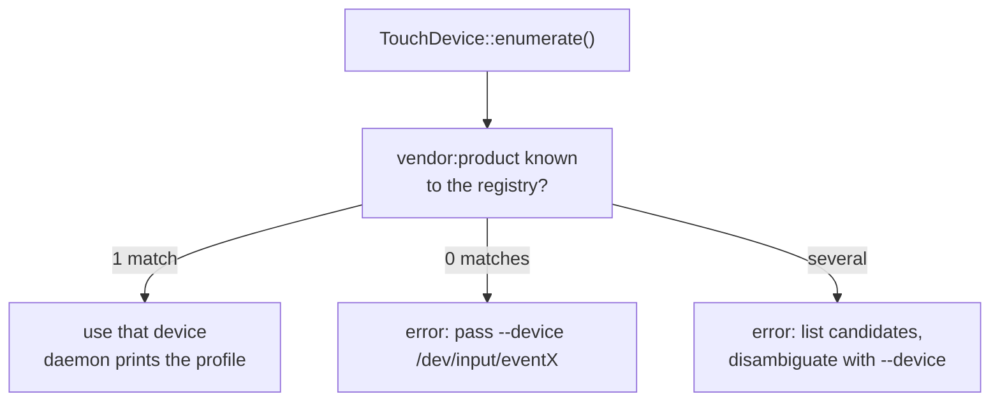

# Device Detection

How the daemon finds its input device — enumeration, profile matching and
resolution rules. Data shapes live in [`DATA_MODEL.md`](DATA_MODEL.md).

## Registry loading

`DeviceRegistry::builtin()` parses the compiled-in profiles
(`crates/model/devices/*.toml` via `include_str!`);
`registry.with_dir(dir)` merges every `*.toml` of `--device-profiles <dir>`
after the builtins. Load failures never abort — they collect into
`registry.errors` and the daemon prints a warning per file, same
convention as `ProfileDir`.

Lookups:

| Method          | Order | Notes |
|-----------------|-------|-------|
| `find_by_name`  | exact, then case-insensitive | `--to <name>` resolution |
| `find_by_ids`   | `vendor == && product ==` | Auto-detection matching |
| `resolve`       | registry name, then TOML file path | `--convert-device --to` accepts both |

## Enumeration

`TouchDevice::enumerate()` opens `/dev/input/event0..31` and records each
node's `input_id()` — vendor/product IDs, kernel name and whether the
`ABS_MT_SLOT` axis exists (`is_multitouch`, protocol type B). `--list`
prints them as

```
/dev/input/event3: SiS HID Touch Controller [0457:11dc] [Multitouch]
```

—the IDs shown are exactly what goes into a new `DeviceProfile` TOML.

## Auto-detection

When `--device` is omitted, `run_live`/`run_record`/`run_train` call
`TouchDevice::detect(&registry)`:



Explicit `--device /dev/input/eventX` always wins and skips detection.

On a match the daemon prints the recognized profile:

```
Gerät erkannt: SiS HID Touch Controller (SiS HID Touch Controller) → /dev/input/event3
```

### Deliberate limits

- The profile match only selects **which** device — calibration still
  comes from `ABS_INFO` at open (more accurate than static profile values).
- Devices without a known profile are never guessed — a multitouch
  touchpad auto-selected as "the touchscreen" would be worse than a clear
  error. Unknown hardware gets a `DeviceProfile` first.
