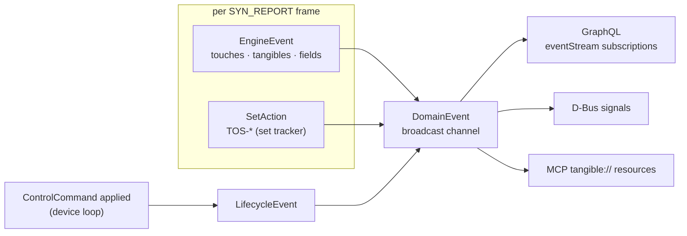

# Domain Events

The domain event model in `model/src/domain` - the typed stream every
interface subscription consumes (GraphQL subscriptions, D-Bus signals,
MCP resource notifications). Raw evdev events are a different layer -
see [`DATA_MODEL.md`](DATA_MODEL.md).

```
crates/model/src/domain/
├── mod.rs                      - module docs + re-exports
├── domain_event.rs             → DomainEvent
├── engine_event.rs             → EngineEvent
├── tangible_event.rs           → TangibleEvent   (flat wire shape)
├── lifecycle_event.rs          → LifecycleEvent
├── event_kind.rs               → EventKind       (wire discriminator)
├── stream_event.rs             → StreamEvent     (requestable kinds)
└── stream_event_parse_error.rs → StreamEventParseError
```

## Three event sources, one stream



`DomainEvent` wraps the three sources so subscribers need a single
broadcast channel (`EngineHandle::events`). Emission order per frame:
engine events first, then the set actions derived from the new tracked
state; lifecycle events arrive whenever a control command applies - a
*rejected* command produces no event (SUBSCRIPTIONS.md).

## EventKind - the wire vocabulary

Every event serializes with a `kind` discriminant in `SCREAMING_SNAKE`.
`StreamEvent` is `EventKind` minus `LAGGED` - the lag control event is
never requestable, it fires regardless of the client's kind filter.

| Source | `EventKind` | Payload fields |
|--------|-------------|----------------|
| `EngineEvent` | `TOUCH_POINTS_UPDATED` | - (touches ride in the snapshot/queries) |
| | `TANGIBLE_ADDED` / `TANGIBLE_MOVED` / `TANGIBLE_REMOVED` | `tangible` (`TrackedTangible`) |
| | `FIELD_PLACED` / `FIELD_LIFTED` / `FIELD_COUNT_CHANGED` | `fieldSet`, `field`, `count` |
| `SetAction` | `SET_ADDED` / `SET_REMOVED` | `setId` |
| | `OBJECT_ADDED` / `OBJECT_REMOVED` / `OBJECT_MOVED` | `setId` + `tangible` |
| `LifecycleEvent` | `PROFILE_REGISTERED` / `PROFILE_UNREGISTERED` | `patternId`, `name`, `owner` |
| | `FIELD_SET_REGISTERED` / `FIELD_SET_UNREGISTERED` | `name`, `owner` |
| | `STAGE_REGISTERED` / `STAGE_UNREGISTERED` | `name` (stage scope) |
| | `COMPLETION_CHANGED` / `FILTER_MODE_CHANGED` | `detail` (applied config/mode) |
| | `RECORDING_STARTED` / `RECORDING_STOPPED` | `RECORDING_STOPPED` adds `frames` written |
| | `CONFIG_RELOADED` | file-triggered config reload |
| runtime | `LAGGED` | `skipped` - events dropped on a lagging subscription |

## TangibleEvent - the flattened wire shape

Interfaces serialize one flat struct; `kind` says which fields are
populated (all others stay empty):

| Field | Rust type | Carries |
|-------|-----------|---------|
| `kind` | `EventKind` | discriminator |
| `tangible` | `Option<TrackedTangible>` | `TANGIBLE_*` + `OBJECT_*` |
| `set_id` | `Option<TangibleSetId>` | `SET_*` + `OBJECT_*` |
| `field_set` / `field` | names | `FIELD_*` |
| `count` | `Option<FrameCount>` | `FIELD_COUNT_CHANGED` |
| `frames` | `Option<FrameCount>` | `RECORDING_STOPPED` |
| `pattern_id` | `Option<PatternId>` | `PROFILE_*` |
| `name` | `Option<String>` | profile / field-set / stage name - deliberately heterogeneous |
| `owner` | `Option<Owner>` | registration events |
| `detail` | `Option<String>` | applied value of config events |
| `skipped` | `Option<u64>` | `LAGGED` |

## Subscriptions

| Interface | Surface |
|-----------|---------|
| GraphQL | `eventStream(kinds, patternId?, setId?, maxHz?)` - explicit filter; `tangibleEvents(patternId?)` and `fieldEvents(set?)` presets; `events` deprecated |
| D-Bus | per-kind signals: `tangible_added`, `tangible_moved`, `tangible_removed`, `touch_points_updated`, `set_added`, `set_removed`, `object_added`, `object_removed`, `object_moved`, `field_placed`, `field_lifted`, `field_count_changed`, `lifecycle_event` (JSON string of the `LifecycleEvent`) |
| MCP | no stream - `tangible://` resources provide read snapshots (`tangibles`, `touch-points`, `sets`, `profiles`, `field-sets`, `recording`, `message`) |

- `maxHz` throttles the high-rate `TOUCH_POINTS_UPDATED` kind
  (default 30 Hz); all other kinds pass unthrottled.
- `patternId`/`setId`/`fieldSet` narrow the stream server-side.
- **`LAGGED` recovery**: a `LAGGED` event reports how many events this
  subscription dropped; the client's recovery is re-read the snapshot
  (`tangibles`/`sets`/`fieldSets` queries) and continue the stream
  (SUBSCRIPTIONS.md reconnect semantics).

## Design rules

- **Applied outcomes only**: the device loop emits a lifecycle event
  when a control command *took effect* - rejected registrations and
  ignored commands stay silent, so subscribers mirror reality.
- **Engine vs. lifecycle**: `EngineEvent`s are frame-derived (touch and
  tracking facts); `LifecycleEvent`s are session facts (config and
  registration changes) - same channel, different provenance.
- `TrackedTangible` hides tracker internals for the wire; the recording
  schema keeps `frames_since_match` separately
  ([`../recording/DATA_MODEL.md`](../recording/DATA_MODEL.md)).
