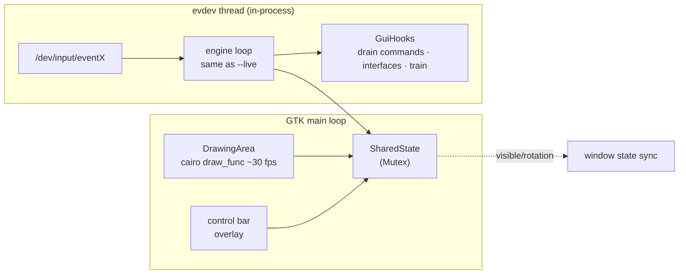

# Embedded GUI (`--gui`)

Daemon-embedded GTK4 visualization - the crate `tangible-objects-gtk`
(`crates/gtk`), enabled by `--gui` (daemon feature `gui`). Not a remote
client: the engine/device loop runs in-process on a background thread
and the GTK main loop renders the shared state - zero-latency event
flow, fullscreen on the touch surface itself. The embedding daemon
injects its plumbing via [`GuiHooks`](#guihooks) so this crate never
links the daemon crate.

```
crates/gtk/src/
├── lib.rs              - crate docs + run_gui entry point
├── evdev_thread.rs     - in-process engine/device loop thread
├── shared_state.rs     → SharedState   (Mutex'd frame state)
├── gui_options.rs      → GuiOptions    (visible · rotation · alpha · dead-zones)
├── gui_mode.rs         → GuiMode       (Live | Training)
├── gui_hooks.rs        → GuiHooks      (daemon-injected callbacks)
├── background_alpha.rs → BackgroundAlpha (canvas fill opacity)
├── control_bar.rs      - bottom control bar widget
├── draw.rs             - cairo scene rendering
└── i18n.rs             - Fluent loader (i18n/*.ftl)
```

## Runtime structure



- `run_gui` spawns the evdev thread, builds the fullscreen
  `ApplicationWindow` (`DrawingArea` + control bar `Overlay`), and
  calls `app.run_with_args(&["tangible-objects"])` - only argv[0] is
  passed so GTK never sees daemon flags like `--gui`/`--device`
  ("Unbekannte Option").
- A `glib::timeout_add_local` ~30 fps tick queues redraws and syncs
  `SharedState.visible` into the window (`SetGuiVisible` commands).
- **Esc** exits the application (`std::process::exit(0)`).

## GuiHooks (daemon injection)

`run_gui`'s last parameter - the crate boundary. The daemon wires its
own `modes::*` functions in:

| Hook | Daemon function | Purpose |
|------|-----------------|---------|
| `spawn_interfaces` | `modes::spawn_interfaces` | GraphQL/MCP/D-Bus servers on the `EngineHandle` |
| `drain_control_commands` | `modes::drain_control_commands` | applies `ControlCommand`s on the device loop (registration, recording, GUI toggles) |
| `status_of_session` | `modes::status_of_session` | console/status text |
| `effective_calibration` | `modes::effective_calibration` | device-profile resolution override vs. `ABS_INFO` |
| `register_profile` | `modes::register_profile_hook` | save a trained figure from the control bar |

## Rendering state

| Option / command | Type | Effect |
|------------------|------|--------|
| `--display-rotation <0\|90\|180\|270>` | `DisplayRotation` | quarter-turn of evdev positions in the mm→px mapping (`mm_to_screen`) - matches a rotated desktop session (e.g. GNOME portrait on a landscape panel); runtime change via `setDisplayRotation`/`set_display_rotation` |
| `--background-alpha <0-100>` | `BackgroundAlpha` | opacity of the canvas `.surface-bg` CSS layer - lower values let the desktop show through; touches/labels/chrome stay opaque. Control-bar button cycles the presets; runtime change via `SetBackgroundAlpha` (`setBackgroundAlpha` / `set_background_alpha`) |
| `SetGuiVisible` command | bool | shows/hides the window without restarting the GUI (`setGuiVisible` / `set_gui_visible`) |
| `--dead-zones-visible` | bool | draws the dead-zone overlay at startup: each registered zone renders as a dashed red circle + name beneath the figure layer; runtime toggle via `SetDeadZonesVisible` (`setDeadZonesVisible` / `set_dead_zones_visible`) |
| `--edge-margin-visible` | bool | draws the edge-margin overlay at startup: semi-transparent bands + dashed inner border where edge-ghost contacts are ingest-filtered; runtime toggle via `SetEdgeMarginVisible` (`setEdgeMarginVisible` / `set_edge_margin_visible`) or the `Edge` control-bar toggle |
| `--fields-visible` | bool | draws the field-set overlay at startup: dashed, semi-transparent regions per field incl. window-anchored sets resolved to screen mm; runtime toggle via `SetFieldsVisible` (`setFieldsVisible` / `set_fields_visible`) or the `Fields` control-bar toggle |
| `--ruler-visible` | bool | draws the ruler overlay at startup: pixel ticks on the left edge, millimeter ticks on the bottom edge; runtime toggle via `SetRulerVisible` (`setRulerVisible` / `set_ruler_visible`) or the `Ruler` control-bar toggle |
| `--positions-visible` | bool | draws the positions overlay at startup: `x_mm,y_mm | x_px,y_px` labels at touch points, tangible centers and field centers; runtime toggle via `SetPositionsVisible` (`setPositionsVisible` / `set_positions_visible`) or the `Positions` control-bar toggle |
| `--touch-passthrough` | bool | touches fall through the GTK window to the desktop beneath, except where GUI elements (control bar) are hit - the surface input region is reduced to the control-bar rect; runtime toggle via `SetTouchPassthrough` (`setTouchPassthrough` / `set_touch_passthrough`) or the `Pass` control-bar toggle. Wayland only (no-op on X11). At startup the flag also puts the window into the layer-shell `Overlay` layer (gtk4-layer-shell) so it stays above the windows receiving the through-clicks - a regular toplevel would lose stacking when the click focuses the window beneath (GNOME), and GTK4 has no `keep_above` |
| `--filter-mode <mode>` | `FilterMode` | initial suppression policy shown in the GUI (`off`/`immediate`/`gated`/`guarded`/`tangibles-only`); the control-bar button set issues `SetFilterMode` - honored by the proxy in `--filter` mode, display state in `--gui` |
| `showMessage` / `ShowMessage` | string | large centered overlay text; empty clears - scripted training instructions ([`../analysis/METRICS.md`](../analysis/METRICS.md)) |

The window background itself is transparent (`window { background-color:
transparent }` at application priority) so the canvas alpha actually
reveals the desktop beneath; pending partial-spawn tangibles render
dimmed ([`../pattern/TRACKING.md`](../pattern/TRACKING.md)).

## Control bar

Bottom overlay: **mode toggle** (live ↔ training), **name entry**,
**save-profile** button (writes `profiles/<name>.toml` via the
`register_profile` hook), **alpha cycle** button, status label. All
strings come from Fluent (`i18n/{de,en}/tangible-objects-gtk.ftl` -
[`../i18n.md`](../i18n.md)).

## Planned

Wayland layer-shell surfaces (`overlay`/`top`/`bottom` layers via
`gtk4-layer-shell`), per-window anchors and rotated input regions -
`concepts/planned/GUI.md` §7. The system dependency
`libgtk4-layer-shell-dev` is already part of the CI image list.
