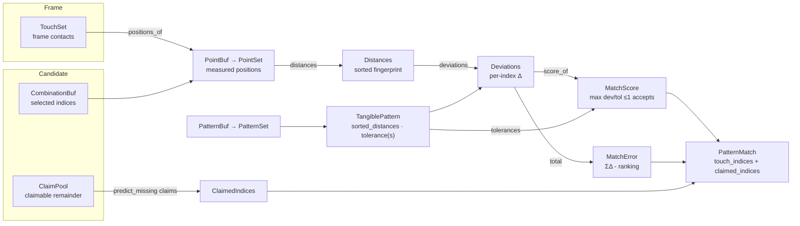

# Pattern Data Model

Geometric figure patterns and their matching within a frame - the module
`model/src/pattern`. A figure is recognized by an invariant fingerprint: all
pairwise distances between its contact pins, sorted ascending. Matching is
therefore position- and rotation-invariant.

```
crates/model/src/pattern/
├── mod.rs               - module docs + re-exports
├── id.rs                → PatternId
├── name.rs              → PatternName
├── pin_count.rs         → PinCount
├── tangible.rs          → TangiblePattern
├── match.rs             → PatternMatch
├── partial_match.rs     → PartialMatch
├── partial_reference.rs → PartialReference
├── distances.rs         → Distances         (sorted fingerprint)
├── deviation.rs         → Deviation         (per-index delta)
├── deviations.rs        → Deviations        (per-index vector)
├── match_error.rs       → MatchError        (Σ deviations - ranking)
├── tolerance.rs         → PatternTolerance  (one slot)
├── tolerances.rs        → PatternTolerances (per-index vector)
├── pattern_set.rs       → PatternSet<'a>    (borrowed registry view)
└── pattern_buf.rs       → PatternBuf        (owned registry)
```

## Matching pipeline



The three `Millimeters`-shaped vectors stay distinct all the way down:
`Distances` (sorted, fingerprint), `Deviations` (fingerprint-index-parallel
delta), `PatternTolerances` (per-index slots). A match folds them into
`MatchError` (ranking) or `MatchScore` (acceptance).

## TangiblePattern

Runtime pattern loaded from a [`ProfileFile`](../profile/DATA_MODEL.md). For
n pins the fingerprint consists of all `n·(n−1)/2` pairwise distances, sorted
ascending.

| Field               | Rust type                        | Notes |
|---------------------|----------------------------------|-------|
| `id`                | `PatternId`                      | Assigned sequentially at profile load (filename order) |
| `name`              | `PatternName`                    | Figure name from the profile |
| `spawn_on_partial`  | `bool`                           | Whether a partial match may *spawn* this tangible (SPAWN_AS_PARTIAL.md); the incumbent path ignores the flag |
| `spawn_stability`   | `FrameCount`                     | Confirmation window for partial spawns (`DEFAULT_SPAWN_STABILITY` = 15) |
| `num_points`        | `PinCount`                       | Required pin count |
| `sorted_distances`  | `Distances`                      | The fingerprint - sorted, index-aligned |
| `tolerance`         | `PatternTolerance`               | Scalar max deviation per distance - fallback for every index and for partial matching |
| `tolerances`        | `PatternTolerances`              | Optional per-distance tolerances parallel to `sorted_distances`; empty or length-mismatched → scalar fallback (TRAINING.md 3.1) |
| `ref_points`        | `Option<Vec<Vec2<Millimeters>>>` | Original pin positions; required for partial matching |
| `regions`           | `Vec<Region>`                    | Detection regions restricting where the figure may match (PROFILE_REGIONS.md); empty = anywhere |

### Matching methods

Measured point sets arrive as `PointSet<'_>` (borrowed view over
`Vec2<Millimeters>`); reference geometry stays `&[Vec2<Millimeters>]`. The
signature says which side of the comparison a value belongs to.

| Method            | Signature                                                  | Semantics |
|-------------------|------------------------------------------------------------|-----------|
| `from_points`     | `(id, name, points: PointSet, tolerance) -> TangiblePattern` | Builds the fingerprint from reference positions; stores them as `ref_points` |
| `accepts`         | `(&self, points: PointSet) -> bool`                        | Spatial gate: every point inside the regions union (empty regions = accept all) |
| `tolerance_at`    | `(&self, index) -> PatternTolerance`                       | Effective tolerance for distance index `i` - per-index value or scalar fallback |
| `matches`         | `(&self, points: PointSet) -> bool`                        | Exact match: `points.len() == num_points` and every deviation ≤ `tolerance_at(i)` |
| `match_score`     | `(&self, points: PointSet) -> MatchScore`                  | Normalized deviation score `max_i dev[i]/tol[i]`; `≤ 1.0` ⟺ `matches` - the score-based ranking metric |
| `score_of`        | `(&self, deviations: &Deviations) -> MatchScore`           | Score of a precomputed deviation vector |
| `match_error`     | `(&self, points: PointSet) -> MatchError`                  | Total absolute deviation across all distances (lower is better) |
| `deviations`      | `(measured: &Distances, reference: &Distances) -> Deviations` | Static per-index delta helper |
| `partial_reference*` | `(&self, skip) / (skips: &[usize]) -> Option<PartialReference>` | One-pin- and multi-pin-dropped reference fingerprints for partial matching |
| `matches_partial*` | `(&self, points: PointSet) -> Option<PartialMatch>`        | Tests `num_points - k` contacts against the dropped-pin references; tolerance raised ×1.5 |
| `predict_missing` | `(&self, …) -> predicted missing pin positions`            | Geometry-based prediction used by completion claiming |

`Distances::of`/`PointSet::distances()` compute the fingerprint; comparison
zips `measured[i]` against `sorted_distances[i]` - the same index alignment
that `CandidateReport.deviations` records in
[recordings](../recording/DATA_MODEL.md).

## PatternMatch

A successful match within a single input frame - produced by the engine's
`find_matches`, consumed by the `Tracker`.

| Field             | Rust type            | Notes |
|-------------------|----------------------|-------|
| `pattern_id`      | `PatternId`          | Matched pattern |
| `pattern_name`    | `PatternName`        | `"(partial)"` suffix for partial matches |
| `center`          | `Vec2<Millimeters>`  | Centroid of the matched touch points |
| `rotation_rad`    | `RotationRad`        | Estimated orientation |
| `touch_indices`   | `CombinationBuf`     | Indices into the frame's touch list |
| `partial`         | `bool`               | `true` for `num_points - k` matches, including completed partials |
| `claimed_indices` | `ClaimedIndices`     | Pins predicted by completion and assigned to the figure though they did not satisfy the fingerprint (TRACKING_STABILIZATION.md) |
| `spawn_stability` | `FrameCount`         | Confirmation window carried from the pattern (partial spawns only) |

| Method             | Signature                                            | Purpose |
|--------------------|------------------------------------------------------|---------|
| `is_partial`       | `(&self) -> bool`                                    | Distinguish certainty without re-inspecting touch counts (the filter proxy suppresses only exact matches) |
| `all_indices`      | `(&self) -> impl Iterator<Item = usize>`             | Matched pins + claimed pins - the consumed-contact set |
| `matched_slots`    | `(&self, touches: TouchSet) -> HashSet<TouchPointSlot>` | `touch_indices` resolved to slots - the genuine-match set (claims excluded) |
| `slots_of`         | `(&self, touches: TouchSet, bind_claimed) -> HashSet<TouchPointSlot>` | The slot binding a track holds over its contacts |
| `rotation_of`      | `(points: PointSet, center) -> RotationRad`          | Orientation: 3 points → vertex opposite the shortest side; 4+ → farthest from centroid |

`PatternMatch` derives `Debug, Clone` only - it is engine output; the
recording pipeline wraps it, it is not serialized directly.

## Newtypes

Three `Millimeters`-shaped vectors mean three different things and are three
types - deviation ≠ distance ≠ tolerance slot. The index types separate a
*selected candidate* (`Combination`/`CombinationBuf`), the *claimable
remainder* (`ClaimPool`), the *claimed result* (`ClaimedIndices`) and the
*whole enumeration* (`Combinations`).

| Type                 | Wraps                     | Purpose |
|----------------------|---------------------------|---------|
| `PatternId`          | `u32`                     | Runtime ID; transparent serde, `Display`, GraphQL scalar, zvariant `Type` |
| `PatternName`        | `String`                  | Figure name; shared by profile, pattern, match and report |
| `PinCount`           | `usize`                   | Required pin count |
| `Distances`          | `Vec<Millimeters>`        | Sorted pairwise-distance fingerprint; `max_deviation` → `Deviation`, `deviations` → `Deviations` |
| `Deviation`          | `Millimeters`             | Absolute gap `|measured − reference|` at one index - a delta, not a length |
| `Deviations`         | `Vec<Deviation>`          | Per-index deviation vector, parallel to `Distances`; `total()` → `MatchError` |
| `MatchError`         | `Millimeters`             | Σ\|dev\| - candidate ranking, lower is better |
| `PatternTolerance`   | `Millimeters`             | One tolerance slot; bare number in TOML for profile compatibility |
| `PatternTolerances`  | `Vec<PatternTolerance>`   | Per-index tolerance vector parallel to the fingerprint |
| `PatternSet<'a>`     | `&'a [TangiblePattern]`   | Borrowed registry view for matching/analysis APIs |
| `PatternBuf`         | `Vec<TangiblePattern>`    | Owned registry (`as_pattern_set()`); `DerefMut` for runtime registration |
| `PartialReference`   | struct                    | Dropped-pin fingerprint + kept indices for partial matching |
| `PartialMatch`       | struct                    | `kept_indices` + `match_error` of a successful partial |

## Design Rules

- Fingerprint comparison is index-aligned: `measured[i]` vs.
  `sorted_distances[i]` - per-index `tolerances[i]` keeps this indexing.
  Partial matching stays scalar by design: dropping a pin re-indexes the
  fingerprint, so per-index tolerances cannot apply there.
- `matches`/`match_error`/`matches_partial*` are pure functions of the point
  set - no engine state, freely callable for diagnostics (`CandidateReport`).
- **Measured vs. reference**: `PointSet`/`PointBuf` carry measured contacts;
  `&[Vec2<Millimeters>]` stays reference geometry. `TouchSet` is the frame's
  contact view; `TouchSet::positions_of(combo)` materializes a candidate's
  `PointBuf`.
