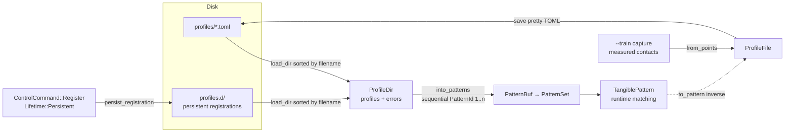

# Profile Data Model

On-disk and in-memory representation of figure profiles - the module
`model/src/profile`. Profiles are hand-managed TOML files under `profiles/`;
they are the persistent form of a [`TangiblePattern`](../../docs/pattern/DATA_MODEL.md)
fingerprint.

```
crates/model/src/profile/
├── mod.rs      - module docs + re-exports
├── file.rs     → ProfileFile, DEFAULT_SPAWN_STABILITY
├── dir.rs      → ProfileDir
└── error.rs    → ProfileError
```

## Lifecycle



One profile file round-trips losslessly: `load` → `ProfileFile` → `to_pattern`
→ matching, and `from_points` → `save` writes the same shape back. Runtime
registrations reuse the identical TOML form in the daemon's store.

## ProfileFile

The TOML-serializable figure profile - the on-disk representation of a
[`TangiblePattern`]. Contains the sorted pairwise-distance fingerprint plus
tolerance, name and optional reference points.

| Field             | Rust type           | TOML                  | Notes |
|-------------------|---------------------|-----------------------|-------|
| `name`            | `PatternName`       | `"TestFigur-5P"`      | Human-readable figure name |
| `enabled`         | `bool`              | `true`                | `false` keeps the file on disk but skips registration (`#[serde(default)]` → enabled) |
| `spawn_on_partial`| `bool`              | `false`               | Whether a partial match may *spawn* this tangible (SPAWN_AS_PARTIAL.md); `false` = conservative default |
| `spawn_stability` | `FrameCount`        | `15`                  | Confirmation window for partial spawns - `DEFAULT_SPAWN_STABILITY` when omitted (~0.25 s at 60 Hz) |
| `num_points`      | `usize`             | `4`                   | Number of contact pins |
| `tolerance`       | `PatternTolerance`  | `3.0`                 | Transparent newtype over `Millimeters` - bare number in TOML; scalar fallback, always required |
| `tolerances`      | `PatternTolerances` | `[2.2, 2.3, …]`       | Optional per-distance tolerances, parallel to `sorted_sides` - the `--analyze` tolerance suggestions render in exactly this format. `#[serde(default, skip_serializing_if)]` |
| `sorted_sides`    | `Distances`         | `[34.1, 36.8, …]`     | Sorted pairwise distances - the fingerprint |
| `points`          | `Vec<Vec2<Millimeters>>` | `[x0, y0, x1, y1, …]` | Optional reference positions, serialized flat for TOML readability (`with = "flat_points"`); enables partial matching |
| `regions`         | `Vec<Region>`       | `[[regions]]`         | Optional detection regions restricting where the figure may match (PROFILE_REGIONS.md); empty = anywhere |

Example (`profiles/testfigur-5p.toml` shape):

```toml
name = "TestFigur-5P"
num_points = 4
tolerance = 3.0
# optional - per-index refinement (parallel to sorted_sides):
# tolerances = [3.00, 2.26, 2.28, 2.33, 2.35, 2.35]
# optional - partial-spawn opt-in:
# spawn_on_partial = true
# spawn_stability = 15
# optional - [[regions]] blocks restricting the match area
sorted_sides = [33.32, 36.52, 35.11, 44.83, 53.5, 53.62]
points = [0.0, 0.0, 35.11, 0.0, 0.0, 33.32, 35.11, 33.32]
```

### Methods

| Method          | Signature                                              | Purpose |
|-----------------|--------------------------------------------------------|---------|
| `from_points`   | `(name, points: &[Vec2<Millimeters>], tolerance) -> ProfileFile` | Computes the sorted pairwise distances from measured contact positions (used by `--train`) |
| `to_pattern`    | `(&self, id: PatternId) -> TangiblePattern`            | Converts into a matchable pattern; `ref_points` is `Some` only when `points.len() == num_points` |
| `save`          | `(&self, path) -> Result<(), ProfileError>`            | Pretty-prints TOML and writes the file |
| `load`          | `(path) -> Result<ProfileFile, ProfileError>`          | Reads and parses one TOML file |
| `load_dir`      | `(dir) -> ProfileDir`                                  | Loads every `*.toml` in a directory, sorted by filename |

## ProfileDir

Outcome of `ProfileFile::load_dir`: loaded profiles plus the files that
failed, so callers can warn instead of aborting. A missing directory yields an
empty result, not an error.

| Field      | Rust type                          | Notes |
|------------|------------------------------------|-------|
| `profiles` | `Vec<(PathBuf, ProfileFile)>`      | Loaded profiles with their source paths |
| `errors`   | `Vec<(PathBuf, ProfileError)>`     | Files that failed to load, with the error |

`into_patterns()` converts the loaded profiles into a `PatternBuf` of
`TangiblePattern`s with sequential `PatternId`s starting at 1 - deterministic
because the files were sorted by filename. **Note:** the pattern ID space is
therefore load-order-dependent; recordings reference `pattern_id` +
`pattern_name`.

## ProfileError

Error enum (`thiserror`) for profile I/O:

| Variant       | Source              | Meaning |
|---------------|---------------------|---------|
| `Io`          | `std::io::Error`    | Reading or writing the file failed |
| `Deserialize` | `toml::de::Error`   | TOML did not parse into `ProfileFile` |
| `Serialize`   | `toml::ser::Error`  | `ProfileFile` could not be serialized |

## Design Rules

- `ProfileFile` is the **only** type in `model` performing file I/O; the rest
  of the crate is pure data.
- Tolerances and distances are `Millimeters`-based newtypes - profiles are
  device-independent because raw coordinates are calibrated before matching.
- `points` round-trips as a flat `f64` list for TOML readability; the
  `Vec<Vec2<Millimeters>>` reconstruction happens in `to_pattern`.
- Runtime registrations of `Lifetime::Persistent` are saved through the same
  type into the daemon's runtime store (`profiles.d/`) and reload with the
  static set (see [`REGISTRATION.md`](REGISTRATION.md)).
- Recordings (see [`../recording/DATA_MODEL.md`](../recording/DATA_MODEL.md))
  are generated artifacts and deliberately live outside `profiles/`.
