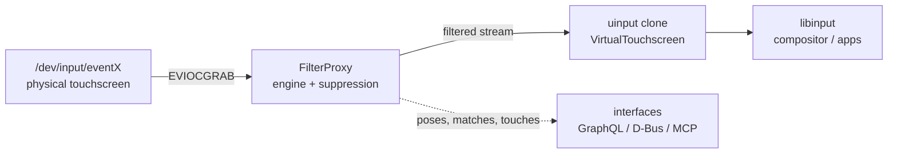

# Filter Proxy: Architecture

`--filter` makes recognized tangibles invisible to the operating system
while the daemon keeps tracking them internally. Setup/permissions:
[SETUP.md](SETUP.md). Filtering semantics: [FILTERING.md](FILTERING.md).

## Data path



1. `TouchDevice::open` → `effective_calibration` (device-profile
   resolution override wins over `ABS_INFO`; see
   `docs/device/DETECTION.md`) → `Engine` gets calibration, patterns,
   optional `edge` margin.
2. `VirtualTouchscreen::create` clones the device 1:1 (name, `InputId`,
   axes with min/max/resolution, keys) and forces `INPUT_PROP_DIRECT` so
   libinput treats it as a touchscreen, not a touchpad.
3. `device.grab()` (`EVIOCGRAB`) - every other consumer of the physical
   device stops receiving events.
4. Per `SYN_REPORT` frame the engine classifies contacts; `FilterProxy`
   emits the filtered stream on the clone.

## Control plane

The filter loop polls the device fd (250 ms) and drains control commands
every iteration - `SetFilterMode` applies even while the screen is idle.
When interfaces are enabled (`--mcp-listen`, `--graphql-listen`,
`--dbus`), clients can switch the suppression policy at runtime:

```text
set_filter_mode(mode: "guarded", stability: 3)   # MCP
setFilterMode(mode: GUARDED, stability: 3)       # GraphQL
set_filter_mode("guarded", 3)                    # D-Bus
```

## Startup

```bash
tangible-objects --filter --device /dev/input/event4 \
    [--edge-filter-mm 3] [--stability-frames 2] [--legacy auto]
```

The console shows `Frame N | touches | figures | suppressed`.

## Latency

At most one frame of buffering (one `SYN_REPORT` period, ~8 ms at
120 Hz). In `Guarded` mode new contacts additionally wait one
classification frame before they appear.
