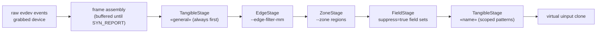

# Filter Pipeline: Staged Suppression

`--filter` does not run one monolithic filter - it runs a `Pipeline` of
stages (`crates/engine/src/proxy`), each a frame-buffered suppression
unit (EVENT_PIPELINE.md). The output of stage *i* feeds stage *i+1*;
the last stage emits on the uinput clone. Per-stage filtering rules:
[FILTERING.md](FILTERING.md); architecture context: [OVERVIEW.md](OVERVIEW.md).

```
crates/engine/src/proxy/
├── pipeline.rs        → Pipeline        (ordered stage chain)
├── stages.rs          → Stages          (collection + scope lookup)
├── stage.rs           → Stage           (trait: push/finish/set_fields)
├── tangible_stage.rs  → TangibleStage   (pattern suppression, scoped)
├── edge_stage.rs      → EdgeStage       (--edge-filter-mm ghosts)
├── zone_stage.rs      → ZoneStage       (--zone masked regions)
├── field_stage.rs     → FieldStage      (suppress=true field sets)
├── scope_changes.rs   → ScopeChanges    (sync_scopes diff)
├── stage_frame.rs     → StageFrame      (per-stage frame state)
├── stage_metrics.rs   → StageMetrics    (per-stage counters)
├── legacy_mode.rs     → LegacyMode
└── virtual_device.rs  → VirtualTouchscreen
```

## Stage chain



| Stage | Created by | Suppresses | Policy |
|-------|-----------|------------|--------|
| `TangibleStage` «general» | `Pipeline::new()` - always first | slots of exact matches (+ `exact`-mode completions) of unscoped patterns | `FilterMode`, own stability gate/hysteresis |
| `TangibleStage` «name» | first `stage = "name"` pattern or `registerStage` | same, for patterns of that scope | own `FilterMode` per scope |
| `EdgeStage` | `--edge-filter-mm` + calibrated surface | contacts within `margin` of the panel border | none - positional |
| `ZoneStage` | `--zone x0,y0,x1,y1` (repeatable) | contacts inside masked rectangles | none - positional |
| `FieldStage` | lazily on the first `set_field_sets` call | contacts inside `suppress = true` fields | none - field-driven |

The chain preserves **insertion order**: the general stage is always
first; edge/zone/field stages are appended at startup when configured;
named tangible stages are appended whenever their first scoped pattern
or `registerStage` arrives - a late-registered stage therefore sits
*behind* the positional stages. Suppressed slots are invisible to later
stages' matching, so ordering is semantic: what an earlier stage drops
never reaches a later stage's classifier.

## Scopes: implicit vs. explicit

A `StageName` scope lives and dies with its patterns **or** with an
explicit registration:

- **Implicit**: `sync_scopes` diffs the pipeline's tangible scopes
  against the engine's pattern scopes each frame; a new `stage = "…"`
  pattern creates the stage (`ensure_tangible_stage`), a scope whose
  last pattern vanished is garbage-collected.
- **Explicit**: `ControlCommand::RegisterStage` marks the stage explicit
  - it survives `sync_scopes` even with zero patterns, so a client can
  pre-configure a stage's filter policy before its profiles exist.
  `UnregisterStage` removes it (its suppression state dies with it).

Scope transitions emit `ScopeChanges` → lifecycle events
`STAGE_REGISTERED`/`STAGE_UNREGISTERED`
([`../event/DOMAIN_EVENTS.md`](../event/DOMAIN_EVENTS.md)).

## Scoped filter policies

`SetFilterMode { mode, stability, stage }`:

| `stage` | Effect |
|---------|--------|
| `None` | broadcast - every tangible stage adopts the mode/stability |
| `Some(name)` | only that stage reconfigures; positional stages (`EdgeStage`/`ZoneStage`/`FieldStage`) always ignore `SetFilterMode` |

Interfaces: `setFilterMode(mode, stability, stage)` (GraphQL),
`set_filter_mode(mode, stability, stage?)` (MCP), `set_filter_mode(mode,
stability, stage)` (D-Bus); stages via `registerStage`/`register_stage`
([`../profile/REGISTRATION.md`](../profile/REGISTRATION.md)).

## Per-stage state & metrics

Each `TangibleStage` repeats the suppression machinery documented in
[FILTERING.md](FILTERING.md) - `emitted`/`pending`/`suppressed`/`held`
maps, graduation gate, 30-frame hysteresis, retraction injection -
independently per scope. `Stages::stage_metrics` feeds the console
line's `suppressed`/`forwarded` counters; `merged_mode`/`merged_gate`
describe the effective policy across stages.
