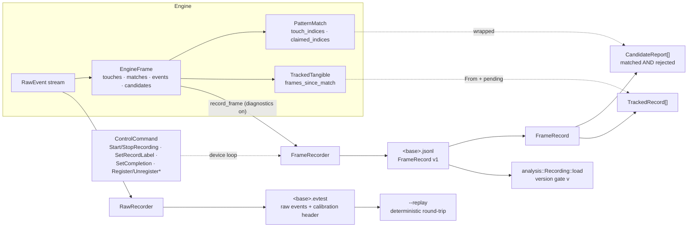

# Recording Data Model

Data model for the frame recording pipeline described in
[`concepts/done/TRAINING.md`](../../concepts/done/TRAINING.md). It defines
the JSONL frame schema (`"v": 1`), the newtypes that carry it, and the control
commands that steer a recording session. The raw wire format - field-by-field
with JSON examples - lives in [`JSONL_FORMAT.md`](JSONL_FORMAT.md).

A recording session produces **two artifacts**:

| Artifact        | Content                                              | Written by      |
|-----------------|------------------------------------------------------|-----------------|
| `<base>.jsonl`  | One `FrameRecord` per non-empty `SYN_REPORT` frame   | `FrameRecorder` |
| `<base>.evtest` | Every `RawEvent` in `evtest` text format + calibration header | `RawRecorder`   |

The `.evtest` file preserves full reproducibility: replaying it via `--replay`
must regenerate the same frame stream deterministically.

## Pipeline & record shape



One `.jsonl` line is one `SYN_REPORT` frame; the sibling `.evtest` holds the
unprocessed raw stream so a replay regenerates the same frame sequence.

## Module Layout

The record types live in `tangible-objects-model` so the engine, the daemon
and future analysis tools share one definition without depending on I/O.
`model` stays dependency-light (serde/toml only) - all types are
`Serialize`-only where nothing reads them back in Rust.

```
crates/model/src/
├── milliseconds.rs        → Milliseconds          (unit newtype)
└── recording/
    ├── mod.rs             - module docs + re-exports
    ├── label.rs           → RecordLabel
    ├── tracked.rs         → TrackedRecord
    ├── candidate/
    │   ├── mod.rs         - re-exports
    │   ├── report.rs      → CandidateReport
    │   ├── count.rs       → CandidateCount
    │   └── score.rs       → MatchScore
    └── frame/
        ├── mod.rs         - re-exports
        ├── record.rs      → FrameRecord, RECORD_SCHEMA_VERSION
        ├── number.rs      → FrameNumber            (ordinal)
        ├── count.rs       → FrameCount             (grows only)
        └── remaining_count.rs → RemainingFrameCount (depleting budget)
```

Three distinct frame quantities are kept apart deliberately:
`FrameNumber` is an ordinal ("frame 47"), `FrameCount` a cardinality that
only grows ("47 frames"), `RemainingFrameCount` a budget that only shrinks
("47 frames left", saturating `SubAssign`).

## FrameRecord

`FrameRecord` is one JSONL line - the state of a single `SYN_REPORT` frame.
Written only for frames with touches or tracked tangibles; an idle surface
produces no output.

| Field            | Rust type                | JSON                 | Notes |
|------------------|--------------------------|----------------------|-------|
| `schema_version` | `u16`                    | `"v": 1`             | Serialized as `"v"`; analysis must refuse unknown versions |
| `frame`          | `FrameNumber`            | `1024`               | Sequential `SYN_REPORT` count; skipped empty frames leave gaps |
| `timestamp_ms`   | `Milliseconds`           | `12345678`           | Milliseconds since recording start |
| `label`          | `Option<RecordLabel>`    | `"testfigur-5p"`/`null` | Ground truth; explicit `null` marks unlabeled frames |
| `calibration`    | `Option<Calibration>`    | `{…}`/`null`         | `null` = device uncalibrated → positions are raw axis values |
| `touches`        | `Vec<TouchPoint>`        | `[{slot, tracking_id, x, y}]` | Flat shape via `#[serde(flatten)]` on `pos` |
| `candidates`     | `Vec<CandidateReport>`   | `[{…}]`              | Every tested combination, matched *and* rejected |
| `tracked`        | `Vec<TrackedRecord>`     | `[{…}]`              | Tracker view incl. `frames_since_match` |
| `raw_dropped`    | `EventCount`             | `0`                  | Running count of raw events dropped on a full sink buffer; non-zero breaks round-trip equality |

`RECORD_SCHEMA_VERSION: u16 = 1` is written into every record - bump it when
the shape changes; the stream is append-only within a session.

## CandidateReport

One entry per point combination tested against a pattern. `find_matches`
keeps only the best combination per pattern; the opt-in diagnostics path
(`Engine::process_with_diagnostics` → `find_matches_with_diagnostics`, sink
trait `CandidateDiagnostics` - lazy `FnOnce` construction, zero cost on the
production path) emits a `CandidateReport` for **all** of them so rejected
near-misses feed the collision analysis. Reports land in
`EngineFrame::candidates`.

| Field                | Rust type            | Notes |
|----------------------|----------------------|-------|
| `pattern_id`         | `PatternId`          | Pattern under test |
| `pattern_name`       | `PatternName`        | Denormalized for readable analysis output |
| `touch_indices`      | `CombinationBuf`     | Indices into the frame's `touches` - the selected combination |
| `matched`            | `bool`               | Combination passed the tolerance check |
| `partial`            | `bool`               | `num_points - 1` attempt (one pin missing) - compares against a subset fingerprint |
| `measured_distances` | `Distances`          | Sorted pairwise distances; index `i` ↔ `sorted_distances[i]` |
| `deviations`         | `Deviations`         | `\|measured[i] − reference[i]\|`, parallel to `measured_distances` - the raw basis for per-pair analysis |
| `tolerance`          | `PatternTolerance`   | Scalar tolerance applied during the test (also the fallback for partial candidates - pin-drop re-indexes the fingerprint) |
| `tolerances`         | `PatternTolerances`  | Per-index tolerances when the pattern configures them; **absent** (not `null`) when scalar-only - `#[serde(default)]` keeps older recordings loadable |
| `score`              | `Option<MatchScore>` | Normalized `max_i dev[i]/tol[i]` score; `None` in older recordings - `normalized_score()` recomputes it from `deviations`/`tolerances` |
| `match_error`        | `MatchError`         | Total absolute deviation; recorded for rejected candidates too |

Derived helpers on `CandidateReport`: `required_tolerance()` →
`PatternTolerance` (`max(deviations)` - the tolerance at which the candidate
would have matched), `tolerance_at(i)` (effective per-index tolerance),
`normalized_score()` (stored score or recomputed), `matches_label()` (name or
numeric id).

## TrackedRecord

The tracker's view of a tangible within a frame. Unlike the interface-facing
serialization of `TrackedTangible` (which hides internals), the record keeps
`frames_since_match` - the flappy-contact analysis needs to distinguish raw
matches from stably tracked objects.

| Field                 | Rust type             | JSON            |
|-----------------------|-----------------------|-----------------|
| `id`                  | `TangibleId`          | `10`            |
| `pattern_id`          | `PatternId`           | `5`             |
| `pattern_name`        | `PatternName`         | `"TestFigur-5P"`|
| `center`              | `Vec2<Millimeters>`   | `{"x":…,"y":…}` |
| `rotation_rad`        | `RotationRad`         | `"rotation_deg": -143.73` (degrees) |
| `frames_since_match`  | `FrameCount`          | `0`             |
| `pending`             | `bool`                | `false`         |

`TrackedRecord` implements `From<&TrackedTangible>` and a manual `Serialize`
mirroring `TrackedTangible`'s convention (`rotation_deg` in degrees, `center`
as an `{x, y}` object).

## Newtypes

Consistent with the existing unit newtypes (`Millimeters`, `Pixels`,
`RawAxisValue`): transparent serialization, `new()`/`as_*` accessors, `From`
conversions, `Display`.

| Type                  | Wraps    | Purpose |
|-----------------------|----------|---------|
| `Milliseconds`        | `u64`    | Frame timestamps; `From<Duration>`/`Into<Duration>` |
| `FrameNumber`         | `u64`    | Frame ordinal - session-local `SYN_REPORT` counter |
| `FrameCount`          | `u64`    | Frame cardinality; `AddAssign` - grows only, never decrements |
| `RemainingFrameCount` | `u64`    | Depleting frame budget; saturating `SubAssign` + `is_expired` |
| `CandidateCount`      | `u64`    | Count of candidate reports - distinct from frame counts (one frame can hold several matched candidates) |
| `MatchScore`          | `f64`    | Normalized deviation ratio; `≤ 1.0` ⟺ matched |
| `RecordLabel`         | `String` | Ground-truth tag (`--record-label`, keypress, API) |

The geometric fields borrow the pattern module's newtypes - deviation ≠
distance ≠ score: `Distances`, `Deviation`/`Deviations`, `MatchError` and
`PatternTolerance(s)` are documented in
[`../pattern/DATA_MODEL.md`](../pattern/DATA_MODEL.md). Index collections are
typed too: `CombinationBuf` for the selected candidate, `ClaimedIndices` for
completion-claimed pins, `Combinations` for the C(n,k) enumeration.

## Units & Markers

- All spatial quantities are `Millimeters` - the same domain as
  `TangiblePattern`. No raw axis values appear in the JSONL; when calibration
  was unavailable `calibration` is `null` and positions stay in raw units -
  the marker records that fact.
- `Calibration`, `UnitsPerMm` and `RawAxisValue` carry `Serialize`/
  `Deserialize` so the calibration snapshot round-trips inside the record.
- `label: null` vs. a label string is how analysis separates positive samples
  (labeled frames) from ambient negatives.

## Control Commands (`runtime`)

Recording is a capability of the daemon's device loop, steered from the
interfaces through `ControlCommand` (`crates/runtime/src/command.rs`):

```rust
enum ControlCommand {
    SetFilterMode { mode: FilterMode, stability: Option<FrameCount> },
    TrainProfile(String),
    StartRecording { base_path: PathBuf, label: Option<RecordLabel> },
    StopRecording,
    SetRecordLabel(Option<RecordLabel>),
    SetCompletion(CompletionConfig),
    ResetMetrics,
    ShowMessage(String),
    Register { registration: Box<Registration>, owner: Option<Owner>, lifetime: Lifetime },
    UpdateProfile { id: PatternId, profile: Box<ProfileFile> },
    UnregisterPattern { id: PatternId },
    UnregisterFieldSet { name: String },
    UnregisterOwner { owner: Owner },
}
```

`StartRecording` carries the artifact base path (`<base>.jsonl` +
`<base>.evtest`); `SetRecordLabel` re-tags subsequent frames - the API
counterpart of the stdin keypress. The `Register`/`Unregister*`/`UpdateProfile`
family implements dynamic profile and field-set registration
(DYNAMIC_PROFILES.md); GraphQL mutations, D-Bus methods and MCP tools map
onto these variants. Registration failures surface as `RegistrationError`
(`engine`) - `PatternNotFound`, `FingerprintCollision`, `FieldsOverlap`,
`DuplicateFieldSet`.

## Design Rules

- **Shared schema**: the same record types serialize in the engine and
  deserialize in `crates/analysis` - no schema drift; the `v` version gate
  still rejects unknown versions.
- **Opt-in diagnostics**: `CandidateReport` is only produced when the
  recording hook is attached; the hot loop allocates nothing otherwise.
- **Versioned & append-only**: every line carries `"v"`; tooling refuses
  unknown versions.
- **Recording artifacts live outside `profiles/`** - profiles stay
  hand-managed, recordings are generated data.
