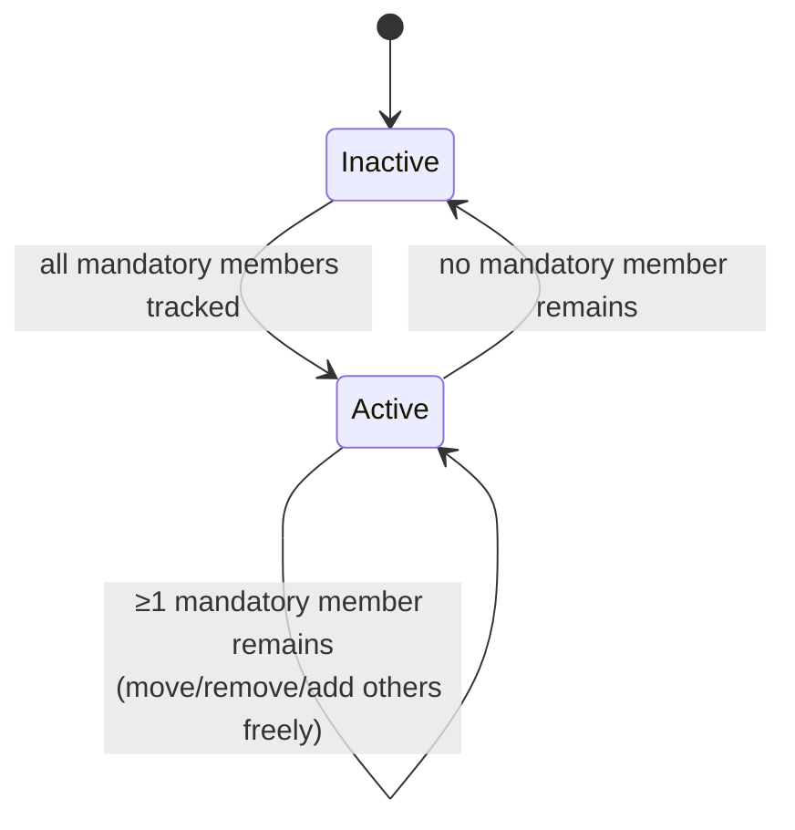

# Tangible Object Sets: Data Model

Groups of tangibles that activate and report together - the module
`model/src/set` (TANGIBLE_OBJECT_SET.md). A set activates when **all**
mandatory member patterns sit on the surface and stays active while **at
least one** remains (activation hysteresis); `additional` members never
affect activation.

```
crates/model/src/set/
├── mod.rs         - module docs + re-exports
├── definition.rs  → TangibleSet       (id · name · mandatory · additional)
├── state.rs       → TangibleSetState  (definition + live `active` flag)
├── id.rs          → TangibleSetId
├── action.rs      → SetAction         (TOS-* domain events)
└── tracker.rs     → SetTracker        (per-frame activation evaluation)
```

## Activation state machine



The hysteresis is the whole point: with two mandatory wooden blocks on
an e-book reader, either block can be lifted, moved and swapped while
the set (the "open book") stays active - only losing *all* mandatory
members closes it (TANGIBLE_OBJECT_SET.md).

## TangibleSet

| Field | Rust type | Notes |
|-------|-----------|-------|
| `id` | `TangibleSetId(u32)` | Set identity |
| `name` | `String` | Human-readable name |
| `mandatory` | `Vec<PatternId>` | All must be present to activate; set dies when none remains |
| `additional` | `Vec<PatternId>` | Optional members - reported via `OBJECT_*` actions, never gate activation |

`contains`/`is_mandatory` classify member patterns. Serializable
(`Serialize`/`Deserialize`), GraphQL `SimpleObject`, zvariant `Type`.

## TangibleSetState

Definition joined with live activation state for interface queries -
serializes flat `{id, name, mandatory, additional, active}`
(`#[serde(flatten)]` on `set`; deserializes both the nested GraphQL
shape and the flat form). Surface: `EngineSnapshot.active_sets`
(`Vec<TangibleSetId>`) plus the `sets` query returning
`Vec<TangibleSetState>`.

## SetAction → domain events

`SetTracker::update(TrackedSet)` diffs each frame's tracked tangibles
against the member patterns and yields the actions the runtime folds
into `DomainEvent`s
([`../event/DOMAIN_EVENTS.md`](../event/DOMAIN_EVENTS.md)):

| `SetAction` | `EventKind` | Meaning |
|-------------|-------------|---------|
| `SetAdded(id)` | `SET_ADDED` | All mandatory members became present (TOS-ADD) |
| `SetRemoved(id)` | `SET_REMOVED` | The last mandatory member disappeared (TOS-REM) |
| `ObjectAdded(id, tangible)` | `OBJECT_ADDED` | A member appeared in an *active* set (TOS-OBJ-ADD) |
| `ObjectRemoved(id, tangible)` | `OBJECT_REMOVED` | A member disappeared from an active set (TOS-OBJ-REM) |
| `ObjectMoved(id, tangible)` | `OBJECT_MOVED` | A member's pose changed in an active set (TOS-OBJ-MOV) |

`OBJECT_*` actions fire only while the set is active; deactivation
clears the per-object state so a re-activation reports members as added
again.

## Wiring status

`EngineRuntime::new(sets, profiles)` takes the definitions at
construction and the `SetTracker` evaluates them per frame - the
interfaces (`sets` query, `SET_*`/`OBJECT_*` events, `eventStream`
`setId` narrowing) are fully wired. The daemon modes currently pass
`Vec::new()`: there is no `sets` file format or registration command
yet, so a daemon reports set events only for embeddings that construct
the runtime with definitions.
