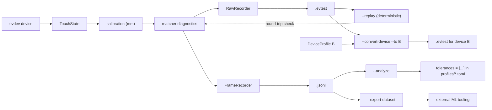

# Training Workflow

End-to-end pipeline for training tangible figures and tuning matching
tolerances - the developer-facing view of
[`concepts/planned/TRAINING.md`](../../concepts/planned/TRAINING.md).
Data shapes are documented per domain: [recording](../recording/DATA_MODEL.md)
(wire format: [JSONL](../recording/JSONL_FORMAT.md)),
[profile](../profile/DATA_MODEL.md), [pattern](../pattern/DATA_MODEL.md),
[analysis](../analysis/DATA_MODEL.md).

## Pipeline



## Recording

```bash
# Live device
tangible-objects --record recordings/session1 --device /dev/input/eventX \
    --record-label TestFigur-4P --profiles profiles

# During recording: type a label + Enter → marks the next ~120 frames;
# empty line / `q` stops cleanly.

# Deterministic replay recording (also usable without hardware)
tangible-objects --replay --file tests/fixtures/figure-tracking-4.txt \
    --record recordings/replay4 --profiles profiles
```

Artifacts: `<base>.jsonl` (one `FrameRecord` per non-empty frame) +
`<base>.evtest` (raw events, replayable). Recording never blocks the
device loop - bounded channels drop with a counter, `raw_dropped` is
reported per frame.

Labels are the ground truth for every downstream evaluation; without them
reports degrade gracefully (collision/score/ML sections print a hint).

## Interfaces

`ControlCommand::{StartRecording, StopRecording, SetRecordLabel}` steer the
daemon's session from GraphQL (`startRecording`, `stopRecording`,
`setRecordLabel`), D-Bus methods and MCP tools - applications can guide a
user through training steps without touching devices or files.

### Remote recording

Interfaces bind `SocketAddr`s - `--graphql-listen 0.0.0.0:8000` /
`--mcp-listen 0.0.0.0:9000` expose the daemon on the LAN. A client on
computer A can steer a session on computer B end-to-end (device info →
start/status/stop → artifact pull) - see
[remote access](../device/CONVERSION.md#remote-access).

## Cross-device conversion

```bash
tangible-objects --convert-device rec-a.evtest --to "Panel B 8k" \
    [--device-profiles devices-extra]
# → rec-a.to-panel-b-8k.evtest   (stats: kept / dropped / clamped)
```

See [device conversion](../device/CONVERSION.md) for the pipeline and its
limits, and [detection](../device/DETECTION.md) for the `--device`
auto-detect rules.

## Analysis

```bash
tangible-objects --analyze recordings/session1.jsonl
tangible-objects --export-dataset recordings/session1.jsonl   # → .dataset.jsonl
```

`--analyze` prints, in order:

1. **Utilization** - deviation percentiles per distance index, bands,
   false negatives (labeled frames without a match).
2. **Tolerance suggestions** - `tolerances = [p99[i] × 1.25]` ready to
   paste into the profile TOML.
3. **Flappy contacts** - tracking-id lifetimes, dropout gaps, partial share.
4. **Collision matrix** - label × foreign pattern collisions and the
   tolerance at which they would appear.
5. **Score sweep** - recall/precision per acceptance threshold τ.
6. **ML baseline** - logistic regression vs. the `score ≤ 1.0` rule on a
   deterministic hold-out.

## Applying results

- Copy the suggested `tolerances = [...]` into `profiles/<fig>.toml`
  (scalar `tolerance` stays required as the fallback and for partial
  matching).
- Collision cells marked `← COLLIDES` indicate profiles whose fingerprints
  are geometrically too close - shrink tolerances or disambiguate.
- `--export-dataset` produces the labeled feature set for external ML
  tooling; use it once score-sweep results show headroom over the rule.

## Verification

- Round-trip: `--replay --file <base>.evtest` must reproduce the recorded
  detection counts exactly (`raw_dropped > 0` breaks this guarantee).
- Determinism: two `--replay --record` runs on the same fixture produce
  identical `.jsonl`.
- Formatting/testing: `cargo fmt --check`, `cargo clippy --workspace
  --all-targets -- -D warnings`, `cargo test --workspace`.
